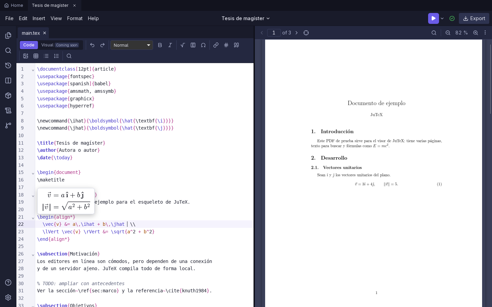
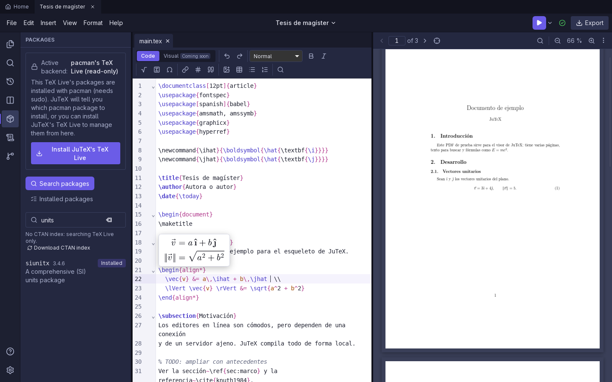
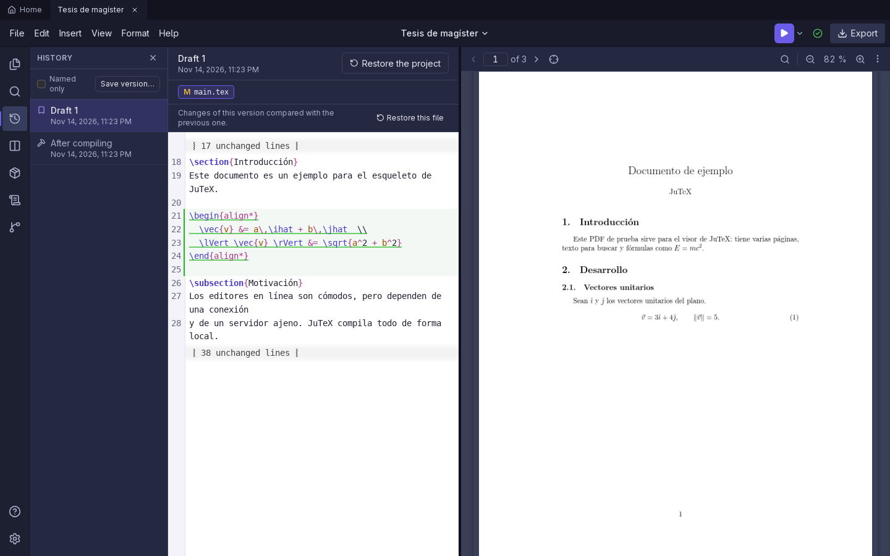
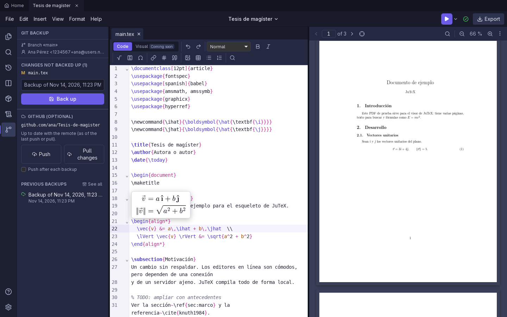
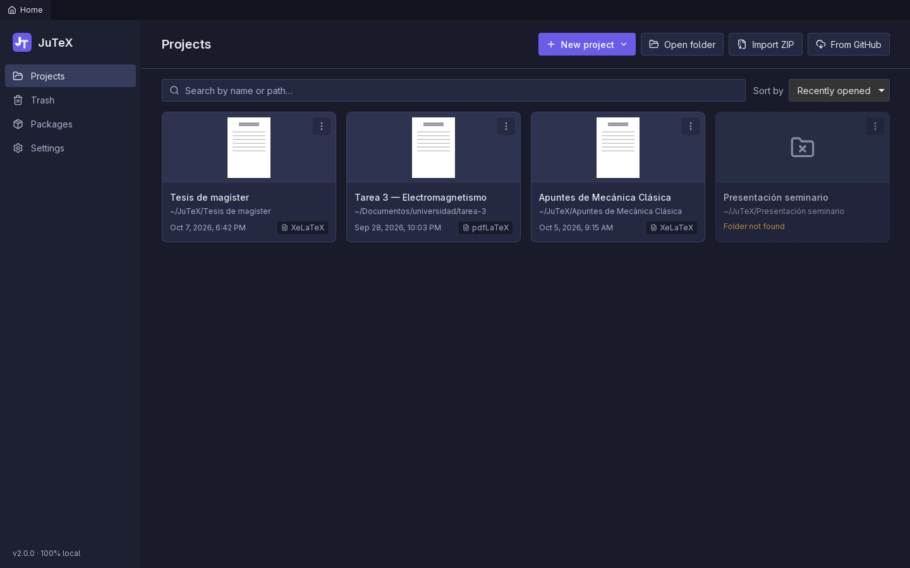

# JuTeX

**English** · [Español](README.es.md)

_Just a TeX editor._ A desktop LaTeX editor with an experience similar to Overleaf, but **100%
local**: your projects live on your disk, they are compiled with your machine's TeX
distribution, and there are no servers, accounts or telemetry. Only the package manager and the
GitHub backup use the internet, and only when you ask.

In six languages: English, Spanish, Portuguese (Brazil), French, German and Italian (see
[Languages](#languages)).

It used to be called LibreTeX; it was renamed because another editor already has that name. If
you come from LibreTeX, see [Moving from LibreTeX to JuTeX](#moving-from-libretex-to-jutex).



## What it does

**Projects**

- Project list with search and sorting; several projects open at once in tabs, and in several
  windows: drag a tab out to see it in another window.
- Create from templates (XeLaTeX article, course notes, homework, Beamer) in any of the six
  languages, open a folder, import a ZIP (Overleaf's too) or bring a project from GitHub.
- Its own trash (the system's): restore or delete permanently.

**Editor**

- CodeMirror 6 with highlighting, folding of environments and sections, automatic closing of
  braces, `$` and environments, comment with `Ctrl+/`, and optional Vim or Emacs keymaps.
- Autocompletion of commands and environments (math ones first inside a formula), of your own
  `\newcommand`s, of the project's `\ref` and `\cite`, and of file paths.
- **Live math preview** with MathJax, which understands your preamble's macros.
- Live checking of unclosed braces, environments and formulas while you type, and spell
  checking in the six languages with a personal dictionary.
- Find and replace in the file and in the whole project (text or regular expression).
- Remembers where you left off: open files, each one's cursor and the PDF page.

**Compiling and PDF**

- `latexmk` with pdfLaTeX, XeLaTeX or LuaLaTeX; always manual (`Ctrl+Enter`), with live output
  and errors linked to their line.
- Built-in PDF viewer that keeps the page and zoom when recompiling, with search and SyncTeX
  both ways (`Ctrl+J` and double click in the PDF).
- Export the PDF (`Ctrl+Shift+S`) or a ZIP of the sources ready for Overleaf.

**Packages**

- Searches TeX Live and CTAN, installs, updates and uninstalls; if a `.sty` or a babel language
  is missing when compiling, it offers to install the package and recompile with one click.
- If your TeX Live is pacman's (read-only), it tells you which pacman package to install.



**History and backup**

- Automatic local history (every few minutes and after compiling) and named versions;
  differences per file, and restore a file or the whole project.
- Optional backup with the project's Git and, if you want, in a private GitHub repository:
  push, pull changes and continue on another machine. JuTeX stores no passwords or tokens.







## Languages

The interface is in English, Spanish, Portuguese (Brazil), French, German and Italian. By
default it follows the system's language (English if the system uses another one); change it
in **Settings → Interface → Language**, and your choice stays when you update.

New documents come in the interface's language, or in the one you choose in **Settings →
Language of new documents** or in the **New project** dialog: the template with its texts,
babel and spell checking in that language. When you open or import a project, JuTeX reads its
babel or polyglossia and checks its spelling in its language. The Portuguese, French, German
and Italian translations are new: corrections are welcome.

## Platforms

- **Linux (Arch):** Arch package and AppImage in the
  [releases](https://github.com/GASDJUGA/jutex/releases); you can also build the package from
  the source with `makepkg -si` in `packaging/arch`.
- **macOS 13 or later, Apple Silicon:** `.dmg` in the releases (see
  [Installing on macOS](#installing-on-macos)).
- **Windows 11 (x64):** installer in the releases, without administrator rights (see
  [Installing on Windows](#installing-on-windows)).

## Requirements (Arch Linux)

```sh
sudo pacman -S --needed webkit2gtk-4.1 git
```

`git` is used for the Git backup. To list your GitHub repositories and create a new one from
the app you also need GitHub CLI (`sudo pacman -S github-cli`, then `gh auth login`).

### TeX distribution (optional)

Compiling needs a TeX distribution, but you don't have to install it first. There are two
ways, and if you have both, you choose which one to use in **Packages** or in **Settings**:

- **JuTeX's TeX Live** (no sudo): in the **Packages** tab, “Install JuTeX's TeX Live”. It
  downloads about 80 MB from CTAN, takes about 210 MB in `~/.local/share/jutex/texlive` and
  does not touch the system. It brings what XeLaTeX needs in the six languages; other packages
  are installed, updated and uninstalled from the app itself.
- **pacman's TeX Live**: JuTeX uses it as it is. Its packages can't be installed from the app;
  when one is missing, JuTeX tells you which pacman package has it. A reasonable set to start
  with:

  ```sh
  sudo pacman -S --needed texlive-basic texlive-latex texlive-latexrecommended \
    texlive-latexextra texlive-xetex texlive-langenglish texlive-binextra
  ```

  plus the group of each other language you write in (`texlive-langspanish`,
  `texlive-langportuguese`, `texlive-langfrench`, `texlive-langgerman`,
  `texlive-langitalian`).

## Installing on macOS

1. Open `JuTeX_<version>_aarch64.dmg` and drag **JuTeX** to **Applications**.
2. The app is not signed with an Apple Developer account, so the first time macOS won't open it
   (“Apple could not verify…”). To open it anyway:
   - **macOS 15 or later:** try to open it once, close the notice and go to **System Settings →
     Privacy & Security**; at the bottom it says “JuTeX was blocked”: click **Open Anyway** and
     confirm.
   - **macOS 13 and 14:** right click (or Control + click) on JuTeX in Applications → **Open** →
     **Open**.
   - If it says the app “is damaged”, remove the download mark from the Terminal:

     ```sh
     xattr -dr com.apple.quarantine /Applications/JuTeX.app
     ```

   After that it opens like any other app.

Everything else, as on Linux, is optional:

- **TeX:** [MacTeX](https://tug.org/mactex/) (`brew install --cask mactex-no-gui`, asks for the
  administrator password) or JuTeX's TeX Live from the **Packages** tab, which needs GnuPG to
  check the download (`brew install gnupg`). With MacTeX, packages are installed with
  `sudo tlmgr install …`; JuTeX gives you the command to copy.
- **Git backup:** `git` comes with Xcode's command line tools (`xcode-select --install`); for
  GitHub, `brew install gh` and `gh auth login`.

## Installing on Windows

1. Run `JuTeX_<version>_x64-setup.exe`. It installs JuTeX only for your user (in
   `%LOCALAPPDATA%\JuTeX`), without asking for administrator rights, and puts it in the Start
   menu. It is uninstalled from **Settings → Apps**; your projects and settings are not
   deleted.
2. The installer is not signed with a code signing certificate, so the first time Windows
   SmartScreen may say “Windows protected your PC”. To install it anyway: click **More info** →
   **Run anyway**. It only happens with the installer downloaded from the internet, and once.

WebView2, the engine that draws the interface, already comes with Windows 11. Everything else
is optional (in PowerShell; no command needs administrator rights):

- **TeX:** [MiKTeX](https://miktex.org) for your user, with the Perl its `latexmk` needs:

  ```powershell
  winget install --id MiKTeX.MiKTeX -e
  winget install --id StrawberryPerl.StrawberryPerl -e
  ```

  JuTeX installs and uninstalls MiKTeX's packages from the **Packages** tab, and MiKTeX can
  install what is missing while compiling. Or, without installing anything first, JuTeX's TeX
  Live from the **Packages** tab (it checks the download with the GnuPG that comes with Git for
  Windows). An official TeX Live installed in `C:\texlive` works too.

- **Git backup:** `winget install --id Git.Git -e`; for GitHub,
  `winget install --id GitHub.cli -e` and `gh auth login`.

## Where JuTeX keeps its files

Projects live wherever you put them (by default `~/JuTeX`; on Windows,
`%USERPROFILE%\JuTeX`; if you already had `~/LibreTeX` from before, that one is used); each one
keeps its metadata, the compiled PDF and the history in its hidden `.jutex/` folder. The rest:

| What                                        | Linux                  | macOS                                           | Windows                            |
| ------------------------------------------- | ---------------------- | ----------------------------------------------- | ---------------------------------- |
| Settings, project list, personal dictionary | `~/.config/jutex`      | `~/Library/Application Support/org.JuTeX.jutex` | `%APPDATA%\JuTeX\jutex\config`     |
| JuTeX's TeX Live, the trash's record        | `~/.local/share/jutex` | `~/Library/Application Support/org.JuTeX.jutex` | `%APPDATA%\JuTeX\jutex\data`       |
| Cache (CTAN index, package catalog)         | `~/.cache/jutex`       | `~/Library/Caches/org.JuTeX.jutex`              | `%LOCALAPPDATA%\JuTeX\jutex\cache` |

They are also shown in **Settings → Paths**.

## Moving from LibreTeX to JuTeX

JuTeX 2.0.0 is the version after LibreTeX 1.2.2 with another name. The first time it opens, it
moves by itself what LibreTeX left: settings, project list, personal dictionary, the app's TeX
Live, the cache and what the window remembered (tabs, cursor, panel sizes). Each project goes
from `.libretex/` to `.jutex/` (with its history) the first time JuTeX reads it. The
`~/LibreTeX` folder with your projects stays where it is. Close LibreTeX before opening JuTeX
for the first time (on Windows, if it is still open, JuTeX asks you to).

- **Arch Linux:** `sudo pacman -U jutex-<version>-1-x86_64.pkg.tar.zst` replaces the `libretex`
  package.
- **AppImage:** delete the `LibreTeX_…AppImage` and use JuTeX's.
- **macOS:** install JuTeX from its `.dmg` and drag **LibreTeX** from Applications to the trash.
- **Windows:** JuTeX's installer does not replace LibreTeX's. Install JuTeX, open it once and
  then uninstall LibreTeX from **Settings → Apps**, without ticking “Delete the application
  data” (if you uninstall it before with that box ticked, what the window remembered is deleted:
  tabs, cursor and panels; projects and settings are not).

## Main shortcuts

On macOS, ⌘ instead of Ctrl (switching tabs is still Ctrl+Tab, or ⇧⌘] / ⇧⌘[).

| Shortcut                           | Action                                     |
| ---------------------------------- | ------------------------------------------ |
| `Ctrl+S`                           | Save (does not compile)                    |
| `Ctrl+Enter`                       | Compile                                    |
| `Ctrl+Shift+S`                     | Save the compiled PDF as…                  |
| `Ctrl+Shift+F`                     | Search the project                         |
| `Ctrl+J` / double click in the PDF | SyncTeX: from the code to the PDF and back |
| `Ctrl+Tab`                         | Next tab                                   |
| `F1`                               | All the shortcuts                          |

## Development

Additional requirements:

```sh
sudo pacman -S --needed rustup nodejs pnpm base-devel curl wget file openssl \
  appmenu-gtk-module libappindicator-gtk3 librsvg
rustup default stable
```

```sh
pnpm install
pnpm tauri dev        # the app in development mode
pnpm test             # frontend tests (Vitest)
pnpm typecheck
pnpm lint
cargo test --manifest-path src-tauri/Cargo.toml
cargo clippy --manifest-path src-tauri/Cargo.toml -- -D warnings
```

`pnpm install` is needed before building the Rust side too: the spelling dictionaries are
bundled from `node_modules`.

Building the application package (on Linux, the AppImage; on macOS, the `.app` and the `.dmg`;
on Windows, the `…-setup.exe` installer; in `src-tauri/target/release/bundle/`):

```sh
pnpm tauri build
```

On macOS the development requirements are Xcode's command line tools
(`xcode-select --install`), Rust with [rustup](https://rustup.rs), Node 26 and pnpm
(`brew install node pnpm`). `scripts/macos/wkprobe.swift` tests the frontend in WKWebView, the
app's engine.

On Windows the development requirements are the Visual Studio 2022 Build Tools with “Desktop
development with C++”, Rust with the MSVC toolchain, Node 26, pnpm and Git for Windows (in
PowerShell):

```powershell
winget install --id Microsoft.VisualStudio.2022.BuildTools -e
winget install --id Rustlang.Rustup -e
winget install --id OpenJS.NodeJS -e
winget install --id pnpm.pnpm -e
winget install --id Git.Git -e
```

The build plan, the design decisions and the project's status are in [`CLAUDE.md`](CLAUDE.md)
(in Spanish). The screenshots come from the browser preview with sample data
(`scripts/screenshots.py`, one set per language).

### Wayland + NVIDIA

With NVIDIA's driver, WebKitGTK's DMA-BUF renderer closes the connection to Wayland (“Error
71”) because of the driver's explicit sync. JuTeX sets `__NV_DISABLE_EXPLICIT_SYNC=1` on
Wayland + NVIDIA, so the page keeps being drawn with the GPU (smooth scrolling). Variables you
already set are respected.

If the window still fails on your system, the previous mode (no acceleration, slower) is
turned on like this:

```sh
JUTEX_SAFE_RENDERER=1 jutex
```

## Contributing and reporting problems

Bugs and ideas go to [Issues](https://github.com/GASDJUGA/jutex/issues). How to set up the
environment and send changes: [CONTRIBUTING.md](CONTRIBUTING.md). Vulnerabilities are reported
privately: [SECURITY.md](SECURITY.md). What is new in each version is in
[CHANGELOG.md](CHANGELOG.md).

## License

[GPL-3.0-or-later](LICENSE).
